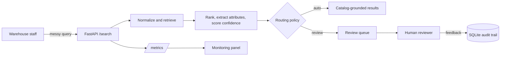

# Parts Distributor Search

Warehouse staff can search a parts catalog using messy descriptions. The API
returns ranked catalog results with confidence and evidence, or routes uncertain
queries for human review.

See [Checklist.md](Checklist.md) for project roles and remaining work.

Live demo: <https://a-parts-distributor-s6rd.vercel.app/>

## Scope and success criteria

The task is: **turn a messy warehouse part description into ranked catalog
SKUs with confidence and evidence, or escalate it to a human reviewer**.

An output is high impact when it is low-confidence, out of distribution,
safety-critical, high-value, or ambiguous between near-duplicate parts.
Those cases must remain reviewable; the system is decision support, not an
authorization to ship a part.

The primary metrics are Top-1 and Top-5 accuracy, hard-case accuracy,
hallucination rate, escalation precision, and p50/p95 latency. We also track
coverage (the share auto-answered), calibration error, and accuracy/error
rates by category, brand, rarity, and query style. The evaluation procedure
and commands are in [`docs/reproduce.md`](docs/reproduce.md).

## Architecture



The frontend is a React/Vite client. The backend loads the deterministic
catalog, performs hybrid retrieval, applies the routing policy, and records
queries and reviewer decisions. Docker Compose starts both services.

## Run with Docker

Install Docker Engine and the Docker Compose plugin, then run these commands
from the repository root:

```bash
docker compose up --build
```

Compose builds and starts the frontend and backend. The backend health check
must pass before the frontend starts.

- Frontend: <http://localhost:8080>
- API health: <http://localhost:8000/health>
- Interactive API docs: <http://localhost:8000/docs>

Press `Ctrl+C` to stop the services. The SQLite database is stored in a named
Docker volume, so it remains available after stopping and restarting the
containers. To stop the services from another terminal, run:

```bash
docker compose down
```

To also delete the saved database and other Compose volumes, run
`docker compose down --volumes`. **This permanently deletes the saved data.**

## Run locally without Docker

Prerequisites: Python 3.12, Node.js 22, and npm.

From the repository root, create a Python environment and install the backend
dependencies:

```bash
python3 -m venv .venv
source .venv/bin/activate
python -m pip install -r backend/requirements.txt
```

In one terminal, start the API:

```bash
cd backend
python -m uvicorn app.main:app --reload
```

On Windows, double-click `backend/Start-Backend.bat`. It selects the
`backend/venv` (or `backend/.venv`) environment, installs the backend
requirements when they are missing, and starts the API with reload enabled.

In a second terminal, install the frontend dependencies and start Vite:

```bash
cd frontend
npm ci
npm run dev
```

Open the local URL printed by Vite (usually <http://localhost:5173>). The API
is available at <http://localhost:8000>.

## Project layout

- `frontend/`: React and Vite warehouse interface
- `backend/`: FastAPI search API and catalog
- `compose.yaml`: local multi-container setup
- `.github/workflows/ci.yml`: backend tests, frontend build, and Docker image build
- `docs/contract.md`: versioned API contract
- `docs/routing.md`: auto-answer and human-review policy
- `docs/risk_register.md`: known risks, mitigations, and human ownership
- `docs/reproduce.md`: reproducible evaluation and demo commands
